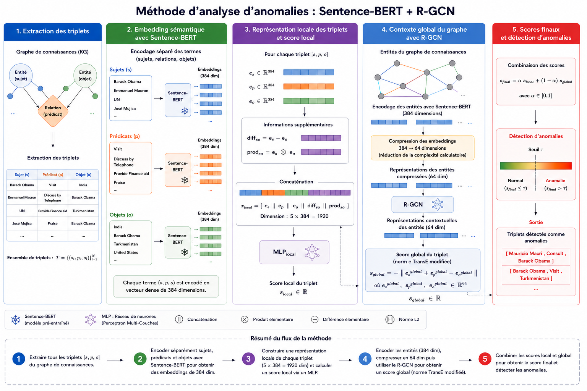

# SERAG - SEmantic–Relational Anomaly Detection in Knowledge Graphs

SERAG detects anomalous events in temporal knowledge graphs by combining two
complementary views of a triple:

- a **local semantic branch**, built from Sentence-Transformer embeddings;
- a **global relational branch**, based on an R-GCN encoder and a TransE score.

The repository also contains a reproducible implementation of **LoGNet**, plus
protocol-compatible research adaptations of **CCA** and **HVSSE**, as well as the
complete data-preparation and repeated-evaluation workflow used for ICEWS18.

The methodology and code were developed by **Antoine Salazar** during his
final-year internship at LIRIS, under the supervision of
[Ludovic Moncla](https://ludovicmoncla.github.io),
[Khalid Benabdeslem](http://kbenabde.free.fr/bk/index.php),
[Rémy Cazabet](https://cazabetremy.fr) and [Yassir Lairgi](https://lairgiyassir.github.io).



## Main results

The following results use the same 30 ICEWS18 snapshots in both protocols,
LLM-generated anomalies, five initialization seeds (41–45), a 10% anomaly
ratio in training, validation, and test, and `alpha = 0.5` for SERAG. Values
are the **mean ± sample standard deviation** across seeds. Anomalies are the
positive class for AUPRC, precision, recall, and F1. Every method checkpoint is
selected on validation AUPRC.

| Protocol | Method | AUROC | AUPRC | Precision | Recall | F1 |
|---|---|---:|---:|---:|---:|---:|
| Pooled | LoGNet | 0.659 ± 0.015 | 0.159 ± 0.010 | 0.152 ± 0.010 | **0.555 ± 0.096** | 0.237 ± 0.013 |
| Pooled | **SERAG** | **0.786 ± 0.003** | **0.321 ± 0.011** | **0.308 ± 0.016** | 0.451 ± 0.055 | **0.364 ± 0.012** |
| Pooled | CCA (adapted) | 0.617 ± 0.006 | 0.145 ± 0.003 | 0.135 ± 0.013 | 0.537 ± 0.182 | 0.210 ± 0.004 |
| Pooled | HVSSE (reproduced) | 0.568 ± 0.017 | 0.125 ± 0.010 | 0.121 ± 0.013 | 0.551 ± 0.171 | 0.194 ± 0.010 |
| Chronological | LoGNet | 0.632 ± 0.018 | 0.146 ± 0.007 | 0.138 ± 0.006 | 0.597 ± 0.147 | 0.223 ± 0.011 |
| Chronological | **SERAG** | **0.737 ± 0.003** | **0.258 ± 0.008** | **0.262 ± 0.028** | 0.389 ± 0.069 | **0.308 ± 0.008** |
| Chronological | CCA (adapted) | 0.597 ± 0.005 | 0.142 ± 0.005 | 0.126 ± 0.007 | 0.542 ± 0.120 | 0.203 ± 0.006 |
| Chronological | HVSSE (reproduced) | 0.525 ± 0.014 | 0.108 ± 0.004 | 0.104 ± 0.002 | **0.699 ± 0.154** | 0.180 ± 0.006 |

SERAG obtains the best AUROC, AUPRC, precision, and F1 in both protocols.
LoGNet is the strongest baseline on ranking and F1. It also obtains the highest
recall in the pooled protocol, while HVSSE obtains the highest chronological
recall, with low precision and high recall variability. CCA and HVSSE are
protocol-compatible research adaptations evaluated on the same manifests, not
exact reproductions of the papers' published experiments; their supervision
assumptions also differ from those of SERAG and LoGNet.

### Influence of the training anomaly ratio

Validation and test remain fixed at 10% anomalies in this experiment. Only the
training anomaly ratio changes. The table reports test AUPRC and F1.

| Protocol | Method | Metric | 1% | 2.5% | 5% | 10% | 20% |
|---|---|---|---:|---:|---:|---:|---:|
| Pooled | LoGNet | AUPRC | 0.184 ± 0.014 | **0.208 ± 0.009** | 0.168 ± 0.008 | 0.159 ± 0.010 | 0.170 ± 0.008 |
| Pooled | LoGNet | F1 | 0.268 ± 0.011 | **0.292 ± 0.012** | 0.248 ± 0.011 | 0.237 ± 0.013 | 0.256 ± 0.005 |
| Pooled | SERAG | AUPRC | 0.231 ± 0.005 | 0.257 ± 0.004 | 0.292 ± 0.005 | 0.321 ± 0.011 | **0.382 ± 0.015** |
| Pooled | SERAG | F1 | 0.300 ± 0.012 | 0.325 ± 0.007 | 0.345 ± 0.006 | 0.364 ± 0.012 | **0.405 ± 0.011** |
| Chronological | LoGNet | AUPRC | **0.164 ± 0.007** | 0.155 ± 0.006 | 0.150 ± 0.008 | 0.146 ± 0.007 | 0.156 ± 0.005 |
| Chronological | LoGNet | F1 | **0.260 ± 0.010** | 0.247 ± 0.008 | 0.232 ± 0.007 | 0.223 ± 0.011 | 0.238 ± 0.007 |
| Chronological | SERAG | AUPRC | 0.215 ± 0.006 | 0.225 ± 0.006 | 0.237 ± 0.007 | 0.258 ± 0.008 | **0.289 ± 0.016** |
| Chronological | SERAG | F1 | 0.276 ± 0.010 | 0.281 ± 0.008 | 0.289 ± 0.004 | 0.308 ± 0.008 | **0.338 ± 0.010** |

SERAG benefits consistently from additional labeled anomalies, whereas LoGNet
peaks at 2.5% in pooled and 1% in chronological evaluation. These are
experimental observations, not ratios selected independently on validation
data. Detailed tables, plots, validation-based selection, and paired confidence
intervals are available in
[`notebooks/llm_ratio_results.ipynb`](notebooks/llm_ratio_results.ipynb).

### Influence of the semantic–relational balance

At a fixed 10% anomaly ratio, `alpha = 0` evaluates the relational branch alone,
while `alpha = 1` evaluates the semantic branch alone. Intermediate values fuse
the two calibrated logits.

| Protocol | Metric | α=0 | α=0.25 | α=0.5 | α=0.75 | α=0.85 | α=0.95 | α=1 |
|---|---|---:|---:|---:|---:|---:|---:|---:|
| Pooled | AUROC | 0.748 ± 0.001 | 0.771 ± 0.001 | **0.786 ± 0.003** | 0.781 ± 0.004 | 0.775 ± 0.004 | 0.769 ± 0.003 | 0.766 ± 0.004 |
| Pooled | AUPRC | 0.257 ± 0.007 | 0.290 ± 0.005 | **0.321 ± 0.011** | 0.307 ± 0.005 | 0.293 ± 0.004 | 0.281 ± 0.004 | 0.275 ± 0.004 |
| Pooled | F1 | 0.327 ± 0.008 | 0.350 ± 0.006 | **0.364 ± 0.012** | 0.357 ± 0.004 | 0.346 ± 0.003 | 0.340 ± 0.007 | 0.337 ± 0.005 |
| Chronological | AUROC | 0.672 ± 0.003 | 0.705 ± 0.004 | 0.737 ± 0.003 | **0.750 ± 0.003** | 0.745 ± 0.004 | 0.740 ± 0.005 | 0.737 ± 0.006 |
| Chronological | AUPRC | 0.173 ± 0.005 | 0.210 ± 0.007 | 0.258 ± 0.008 | **0.276 ± 0.003** | 0.268 ± 0.005 | 0.257 ± 0.006 | 0.252 ± 0.007 |
| Chronological | F1 | 0.250 ± 0.008 | 0.279 ± 0.008 | 0.308 ± 0.008 | **0.316 ± 0.006** | 0.307 ± 0.005 | 0.302 ± 0.006 | 0.302 ± 0.008 |

Neither isolated branch reaches the best fused result. Validation AUPRC selects
`alpha = 0.5` in both protocols. This choice maximizes test AUPRC in pooled; in
chronological evaluation, `alpha = 0.75` has the highest test AUPRC but is a
sensitivity result rather than a validation-selected configuration. The semantic
branch is stronger than the relational branch when used alone. The
validation-selected fusion improves test AUPRC over the semantic-only endpoint
by 0.046 in pooled and 0.006 in chronological evaluation.

## Installation

Python 3.10 or newer is required.

```bash
python -m venv .venv
source .venv/bin/activate
python -m pip install -e .
```

The former `serad-kg-*` commands remain available as compatibility aliases.
The historical internal `serad_kg` Python namespace is also retained so that
existing notebooks, imports, and experiments continue to work.

For tests and development tools:

```bash
python -m pip install -e '.[dev]'
```

## Data

The commands expect an ICEWS18 directory with the following files:

```text
data/icews18/
├── entity2id.txt
├── relation2id.txt
├── train.txt
├── valid.txt
└── test.txt
```

The mapping files contain a label and an integer identifier separated by a tab.
Each split contains subject, relation, object, and timestamp identifiers, plus an
optional fifth column. ICEWS data are not covered by this project's BSD license:
their official terms restrict copying and use to research and education and
prohibit commercial use. See [`data/README.md`](data/README.md) for the detailed
layout, provenance, citation, and licensing notes.

To validate and summarize the dataset:

```bash
serag-describe-data \
  --data-dir data/icews18 \
  --output-dir data/processed/icews18
```

## Reproducing the LLM-anomaly experiments

### 1. Prepare shared manifests

Preparation is deliberately separated from training. It creates immutable
`manifest.csv` files consumed by both methods. Their SHA-256 checksums are copied
to the run configurations so that SERAG and LoGNet can be verified to use the
same examples and splits.

The pooled experiment combines the first 30 snapshots, deduplicates triples, and
then performs a stratified 60/20/20 split:

```bash
serag-prepare \
  --data-dir data/icews18 \
  --output-dir data/processed/icews18/experiments/pooled_30_llm \
  --protocol pooled \
  --negative-sampling cache \
  --anomaly-cache-dir data/processed/icews18/llm_anomalies_30 \
  --num-snapshots 30 \
  --max-anomaly-ratio 0.20 \
  --evaluation-anomaly-ratio 0.10 \
  --train-anomaly-ratios 0.01 0.025 0.05 0.10
```

The chronological experiment uses the same 30 snapshots as the pooled protocol:
snapshots 0–17 for training, 18–23 for validation, and 24–29 for testing. This
preserves temporal order while matching the pooled 60/20/20 allocation:

```bash
serag-prepare \
  --data-dir data/icews18 \
  --output-dir data/processed/icews18/experiments/chronological_30_llm \
  --protocol chronological \
  --negative-sampling cache \
  --anomaly-cache-dir data/processed/icews18/llm_anomalies_30 \
  --num-snapshots 30 \
  --chronological-train-snapshots 18 \
  --chronological-validation-snapshots 6 \
  --max-anomaly-ratio 0.20 \
  --evaluation-anomaly-ratio 0.10 \
  --train-anomaly-ratios 0.01 0.025 0.05 0.10
```

An anomaly ratio is defined as `anomalies / (normal examples + anomalies)`. The
root manifest uses 20% training anomalies. Nested `train_ratio_*` directories use
1%, 2.5%, 5%, and 10%, while sharing the same normal training examples and the
same validation and test sets.

To regenerate anomalies through OpenRouter instead of using the cache, replace
`cache` with `genai` and add:

```text
--openrouter-model openai/gpt-4.1 --genai-batch-size 50
```

Set `OPENROUTER_API_KEY` in `.env`. Generation can incur API costs. If it is
interrupted, rerun the same command with `--resume-genai`; accepted batches are
checkpointed and reused.

### 2. Run the repeated experiments

The reproducible CPU scripts use seeds 41–45, validation-AUPRC checkpoint
selection, 300 maximum epochs for SERAG and LoGNet, patience 25, dynamic score
normalization, no edge masking, no ranking loss, and no saved model weights.
Metrics, per-example scores, histories, plots, configurations, and execution
times are retained. CCA uses at most 20 epochs and HVSSE at most 200 epochs.

The generic sweep scripts below reproduce the pooled 30-snapshot results. They
also retain the earlier `chronological_llm` 10-snapshot experiment for backward
compatibility; use the dedicated launcher shown afterwards for the current
30-snapshot chronological results.

```bash
# SERAG, alpha = 0.5, training ratios 1%, 2.5%, 5%, and 20%
./scripts/run_serag_llm_ratios_cpu.sh

# LoGNet, training ratios 1%, 2.5%, 5%, and 20%
./scripts/run_lognet_llm_ratios_cpu.sh
```

The 10% runs are separate because they were also used for the alpha study:

```bash
# SERAG, alpha values 0, 0.25, 0.5, 0.75, 0.85, 0.95, and 1.0
./scripts/run_serag_llm_cpu.sh

# LoGNet
./scripts/run_lognet_llm_cpu.sh
```

To prepare and rerun the current 30-snapshot chronological study, use the
dedicated resumable launcher. It evaluates SERAG and LoGNet at all five
training-anomaly ratios, runs the SERAG alpha sweep at 10%, and evaluates CCA
and HVSSE for the main 10% comparison:

```bash
caffeinate -i ./scripts/run_chronological_30_llm_cpu.sh
```

It writes the prepared manifests to `chronological_30_llm` and results to
`outputs/cpu_llm_chronological_30`, leaving the former 10-snapshot runs intact.
The main tables in this README and the analysis notebook use these outputs.

The ratio-sweep scripts support resumption: completed seeds are skipped with
`--resume`. On macOS, `caffeinate -i` can keep the machine awake during a long run:

```bash
caffeinate -i ./scripts/run_serag_llm_ratios_cpu.sh
```

## Running one configuration

SERAG example:

```bash
serag-train \
  --data-dir data/icews18 \
  --prepared-data-dir data/processed/icews18/experiments/pooled_30_llm/train_ratio_0.1 \
  --output-dir outputs/example/serag \
  --alpha 0.5 \
  --epochs 300 \
  --patience 25 \
  --score-normalization dynamic \
  --edge-mask-ratio 0 \
  --ranking-loss-weight 0 \
  --device cpu \
  --no-save-model \
  --seeds 41 42 43 44 45
```

LoGNet example using the exact same prepared data:

```bash
lognet-train \
  --data-dir data/icews18 \
  --prepared-data-dir data/processed/icews18/experiments/pooled_30_llm/train_ratio_0.1 \
  --output-dir outputs/example/lognet \
  --epochs 300 \
  --patience 25 \
  --device cpu \
  --no-save-model \
  --seeds 41 42 43 44 45
```

Pass `--resume` to preserve completed seeds when restarting a repeated run.

### CCA and HVSSE research baselines

Protocol-compatible adaptations of CCA and HVSSE can consume the same prepared
manifests:

```bash
cca-train \
  --data-dir data/icews18 \
  --prepared-data-dir data/processed/icews18/experiments/pooled_30_llm/train_ratio_0.1 \
  --output-dir outputs/example/cca \
  --device cpu \
  --no-save-model \
  --seeds 41 42 43 44 45

hvsse-train \
  --data-dir data/icews18 \
  --prepared-data-dir data/processed/icews18/experiments/pooled_30_llm/train_ratio_0.1 \
  --output-dir outputs/example/hvsse \
  --device cpu \
  --no-save-model \
  --seeds 41 42 43 44 45
```

These are not claimed to reproduce the papers' published tables: CCA requires
entity descriptions that ICEWS18 does not provide, while no public HVSSE code was
found. Their provenance, retained components, leakage controls, computational
cost, and comparability limits are documented in
[`docs/cca-hvsse-baselines.md`](docs/cca-hvsse-baselines.md).

To run both methods on the exact LLM-anomaly manifests used for the
LoGNet/SERAG ratio study (1%, 2.5%, 5%, 10%, and 20% training anomalies),
with five seeds per configuration:

```bash
./scripts/run_cca_hvsse_llm_cpu.sh
```

The script supports seed-level resumption and writes one combined comparison
with the existing LoGNet and SERAG results per ratio to
`outputs/cpu_llm_cca_hvsse/comparison_ratio_<ratio>.csv`.

## Model and training

For a local plausibility logit `s_local` and a global relational logit `s_global`,
the combined representation is controlled by `alpha`:

```text
combined = alpha × calibrated(s_local) + (1 - alpha) × calibrated(s_global)
```

Thus `alpha = 1` uses only the semantic branch, `alpha = 0` only the relational
branch, and intermediate values combine both. Each branch is standardized using
training-only statistics and receives a learned positive scale and bias.

The main SERAG configuration uses:

- class-balanced BCE on the combined score;
- an auxiliary BCE loss on each branch (weight 0.25);
- dimension-normalized TransE distances;
- validation AUPRC for learning-rate scheduling, checkpoint selection, and early
  stopping;
- a classification threshold selected exclusively on validation data by maximizing
  anomaly-class F1.

A differentiable pairwise ranking loss and positive-edge masking are implemented
for ablations but disabled in the reported experiments. They can be enabled with
`--ranking-loss-weight`, `--ranking-margin`, and `--edge-mask-ratio`.

## Evaluation and outputs

No test label is used for optimization, early stopping, or threshold selection.
Final precision, recall, F1, AUROC, and AUPRC are computed once on the test set.
AUROC and AUPRC use the continuous anomaly score and do not depend on the selected
classification threshold.

A repeated run produces:

```text
outputs/<experiment>/
├── seed_41/
│   ├── config.json
│   ├── summary.csv
│   ├── scores.csv
│   └── training_history.csv
├── seed_42/
│   └── ...
├── summary_by_seed.csv
├── summary_aggregate.csv
└── overall_aggregate.csv
```

Depending on the protocol, plots and snapshot-specific subdirectories can also be
created. `model.pt` is written unless `--no-save-model` is supplied. The experiment
scripts disable checkpoint storage to limit disk usage while preserving all scores
and timings (`elapsed_seconds`).

## Reproducibility notes

- Use the same prepared-data directory for both methods.
- Compare runs on the same device; CPU was used for the reported tables.
- Keep all five seeds for final comparisons. A single seed is suitable only for
  preliminary debugging.
- Pooled and chronological results answer different questions and should not be
  merged: pooled measures performance on a random split, while chronological
  measures generalization to future snapshots.
- LoGNet and SERAG retain their method-specific optimization procedures. The
  current comparison therefore evaluates the complete methods, not only their
  architectures.

## Tests

```bash
pytest
```

## References

- Michael Schlichtkrull et al., [*Modeling Relational Data with Graph Convolutional
  Networks*](https://arxiv.org/abs/1703.06103), ESWC 2018.
- Antoine Bordes et al., [*Translating Embeddings for Modeling Multi-relational
  Data*](https://proceedings.neurips.cc/paper/2013/hash/1cecc7a77928ca8133fa24680a88d2f9-Abstract.html),
  NeurIPS 2013.
- Alberto García-Durán, Sebastijan Dumančić, and Mathias Niepert,
  [*Learning Sequence Encoders for Temporal Knowledge Graph
  Completion*](https://aclanthology.org/D18-1516/), EMNLP 2018.
- Nils Reimers and Iryna Gurevych,
  [*Sentence-BERT: Sentence Embeddings using Siamese BERT-Networks*](https://aclanthology.org/D19-1410/),
  EMNLP-IJCNLP 2019.

## License

The source code is distributed under the terms of [`LICENSE`](LICENSE). Dataset,
LLM-generated data, and pretrained-model licenses apply independently.
